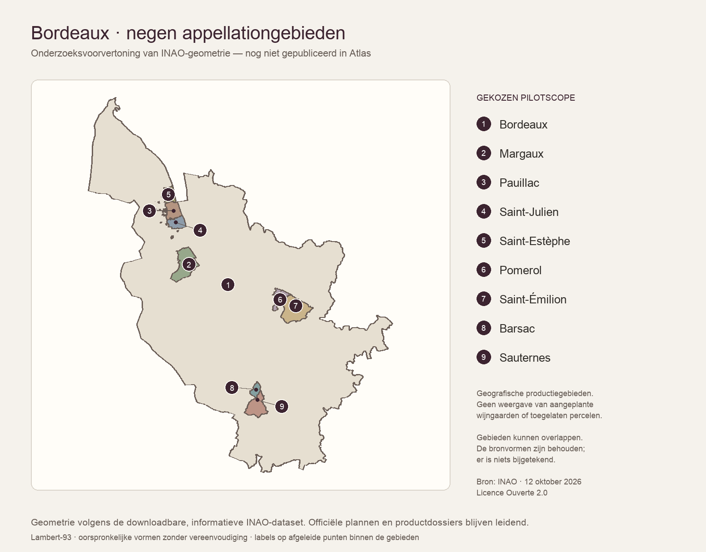

# Bordeaux-Atlas: datasetkeuze en afbakening — 2026-10-14

Review-ID: `QCR-2026-10-14-02`

## Reikwijdte en methode

MNT-051 onderzoekt een kleine verifieerbare Bordeauxpilot, met afzonderlijke
verantwoordelijkheden voor model, import en publieke kaart. Het
[pilot-/importcontract](../docs/atlas-pilot-contract.md) bewaart de uitvoerbare
scope en acceptatiecriteria. Dit rapport bewaart de onderzoekswaarnemingen,
geen levende ticketstatus.

INAO, data.gouv.fr, de officiële INAO-productpagina van Pomerol, Légifrance en
de Licence Ouverte zijn geopend. De primaire geografische ZIP en de aparte
oudere gemeentelijst zijn daadwerkelijk gedownload; bestandsgrootte, SHA-256,
ZIP-members, DBF/CPG, PRJ en de geselecteerde geometrieën zijn gecontroleerd.
De tijdelijke leesomgeving bevat gangbare PyPI-bibliotheken; de exacte versies
staan in het [inspectiebestand](measurements/atlas-bordeaux-data-inspection-2026-10-14.json).
Projectdependencies zijn niet aangepast. Geen screenshottracing, geocoding of
generatieve geografie gebruikt.

## Gekozen scope

De pilot richt zich op negen bestaande actieve appellations: Bordeaux, Margaux,
Pauillac, Saint-Julien, Saint-Estèphe, Pomerol, Saint-Émilion, Barsac en Sauternes.
Dat levert een brede oriëntatie, een Médoc-cluster, een Libournais-contrast en
het Barsac/Sauternes-overlapvraagstuk. De Bordeaux-appellation wordt niet
uitgeroepen tot de grens van de culturele wijnregio of het departement Gironde.

Selecteer de **geografische productiegebieden** uit
[Délimitation des aires-géographiques des SIQO](https://www.data.gouv.fr/datasets/delimitation-des-aires-geographiques-des-siqo),
uitgegeven door INAO, versie 2026-10-12. De negen identifierparen en verwachte
labels staan eenmaal in het contract en als waargenomen input in het
inspectiebestand. Het veld `dt=Bordeaux` is een territoriale INAO-delegatie,
niet een veilige selectie van uitsluitend Bordeauxwijnen.

INAO onderscheidt een geografisch productiegebied van een afgebakende
perceellaag. De [geografische toelichting](https://www.inao.gouv.fr/portail-plans-delimitation)
en de [datasetwaarschuwing](https://www.data.gouv.fr/datasets/delimitation-des-aires-geographiques-des-siqo)
blijven onderdeel van de productbetekenis: de downloadbare vormen dienen
informatief gebruik; officiële dossiers/plannen dragen de juridische afbakening.
De eerste kaart is daarom oriëntatie, geen verklaring dat elk getoond stuk land
met druiven is beplant of een productierecht heeft.

## Onderzochte alternatieven

| Bron | Besluit voor de eerste pilot |
| --- | --- |
| INAO geografische SHP, 2026-10-12 | Geselecteerd; directe bronvormen, bruikbare IDs en hergebruikrechten |
| [INAO perceeldelimitatie](https://www.data.gouv.fr/datasets/delimitation-parcellaire-des-aoc-viticoles-de-linao), 2026-10-12 | Afzonderlijke latere laag: andere betekenis, gedeeltelijke digitale dekking, 267.241.877 bronbytes; niet nodig om de eerste oriëntatie te leveren |
| [INAO gemeentelijst](https://www.data.gouv.fr/datasets/aires-geographiques-des-aoc-aop), 2025-10-09 | Alleen controle-/vergelijkingsbron; eigen `IDA`-namespace, geen polygonen; geen union van hele gemeenten als vervangende grens |
| [IGN Admin Express COG 2026](https://cartes.gouv.fr/aide/fr/partenaires/ign/generalites-ign/actualites/2026-05-admin-express-cog/) | Mogelijke administratieve context bij REG-001; geen vervanger van de gekozen appellationgeometrie. Geen IGN-bestanden geïmporteerd of geometrie/licentie voor gebruik goedgekeurd |
| Producentpunten / wereldwijde druivendata | Andere datavragen; blijven buiten deze pilot |

## Bestand, CRS en rechten

Dataset-ID: `5d7fb2856f444171a5f2780b`. Resource-ID:
`687d62d7-8ee6-4997-a47a-81e3183be31b`. De ZIP bevat één SHP/SHX/DBF-set,
een PRJ en CPG. Het oorspronkelijke bestand is 88.984.476 bytes. SHA-256:
`e9ea8b48c507da006774ad460d03619b464ca6598956ac7fd319f36af4f56bc4`.
De opgegeven SHA-1 komt overeen met de lokaal berekende waarde. De
rechtstreekse resource-URL en wijzigingstijd staan in het inspectiebestand.

De CPG schrijft UTF-8 voor. De PRJ beschrijft RGF93 / Lambert-93 in meters.
Pyproj herkent IGNF:LAMB93 en bevestigt equivalentie met EPSG:2154. Het originele
WKT is bewaard. De onderzoeksomzetting naar EPSG:4326 gebruikt expliciet
longitude/latitude-volgorde (`always_xy=True`). Er is niets gerepareerd,
samengevoegd of vereenvoudigd.

De catalogus noemt **Licence Ouverte 2.0**. De
[licentietekst](https://www.data.gouv.fr/pages/legal/licences/etalab-2.0)
staat hergebruik en afgeleide weergave toe, met bron-/datumvermelding en zonder
suggestie van overheidsgoedkeuring. Het contract bewaart die voorwaarden en
de informatieve betekenis voor de toekomstige legenda en credits.
De bron geeft geen survey-precisie of gegarandeerde kaartschaling op. Dat is
expliciet onbekend, geen toestemming om decimalen als nauwkeurigheid te presenteren.

## Geometrische controle

| Controle | Waarneming |
| --- | ---: |
| Features in landelijke bron | 1.852 |
| Geselecteerde, unieke appellation-/denominationparen | 9 |
| Geldige geometrieën vóór én na reprojection | 9/9 |
| Bronvertices in de selectie | 11.122 |
| Polygon / MultiPolygon | 7 / 2 |
| Geografische selectie als onverkleinde GeoJSON | 453.592 bytes |
| Dezelfde bytes met gzip | 179.873 bytes |
| Deel van Barsac buiten de Sauternesvorm in deze snapshot | 0 m² |

De terugprojectie wijkt numeriek minder dan een micrometer af. Dat controleert
de implementatie van de omzetting; het zegt niets over de nauwkeurigheid van
het brononderzoek. De volledige precisiestatistieken en bboxen staan in JSON.
De geometrische Barsac/Sauternes-containment is geen nieuwe canonical relatie
of bewijs voor een juridisch productierecht.

Alle negen `id_aire`-velden zijn null. Rijpositie en dit veld zijn geen updatekey.
De combinatie van bronversie, `id_app`, `id_denom`, type en gecontroleerde labels
moet het matchingcontract dragen. Onder meer Bordeaux Haut-Benauge en
Saint-Émilion grand cru blijven buiten de gekozen slice, ook bij een gelijkende
naam of identieke vorm.

De gemeentelijst bevat voor Pomerol acht gemeenten en een eigen `IDA=109`,
terwijl de vorm `id_app=62`, `id_denom=121` gebruikt. Dit is een concreet bewijs
waarom de twee namespaces niet op een gelijk getal of oppervlakkige naamjoin
mogen worden gecombineerd. Oude gemeentenamen blijven als bronwaarneming
behouden; de lijst is geen plaatsmodelmigratie of huidige bestuurlijke index.

## Controleerbare PNG-voorvertoning

Deze PNG is een onderzoeksartifact, geen Atlasfeature of canonical bron.
De oorspronkelijke geometrieën zijn met gelijke x/y-schaal in Lambert-93
getekend; er is geen basemap, rivier of regiogrens bijgemaakt. Labels gebruiken
berekende punten binnen de vormen; de kleine verplaatsingen van drukke labels
zijn callouts, geen verplaatste geografische features. De geonamen en de
selectie-JSON bieden het equivalent van de afbeelding. De uitvoer is visueel
gecontroleerd op clipping, verhouding, herkenbaarheid en overlap.

## Direct gecorrigeerd en nieuwe opvolging

Het bestaande `source.inao-pomerol-specification-2021` verwees naar
[het voorstel in nationale oppositieprocedure](https://extranet.inao.gouv.fr/fichier/4-CDC-Pomerol-PNO.pdf).
Pagina 1 vermeldt expliciet dat de voorgestelde wijziging niet vooruitloopt op
de definitieve tekst. De oude titel “modification homologuée en 2021” was
onjuist. Titel en accessdatum zijn gecorrigeerd; de committee-avisdatum van
2 juni is niet langer als bewezen publicatiedatum opgeslagen. ID en historische
provenance blijven intact.

De [INAO-productpagina](https://www.inao.gouv.fr/en/node/6024) en
[het homologatiebesluit](https://www.legifrance.gouv.fr/jorf/id/JORFTEXT000044223580)
wijzen de goedgekeurde tekst uit 2021 bij het ministerie aan. De download
reageerde niet: zowel de webreader als een directe HTTPS-download bereikten
een timeout. Dat is geen bewijs dat het document verdwenen is.
Er zijn daarom geen inhoudelijke Pomerol-regels herschreven of als opnieuw
geverifieerd aangemerkt. **MNT-072** krijgt een afzonderlijke, hoge bron-/claimreview
vóór de juridische publicatiecontrole van die Atlasfeature. Dit is geen
bewezen fout in alle betrokken wijnfeiten; het is wel een ongeschikte bronstage
voor hun presentatie als actuele regels.

## Uitvoering en publicatiegate

MNT-051 levert de afbakening; de kaart staat nog niet op de site. Vervolg:

1. **MNT-072:** Pomerolbron en de daarvan afhankelijke claims controleren.
2. **MNT-070:** minimaal typed geografiemodel, referenties en gegenereerde grens.
3. **MNT-071:** gecontroleerde import, versie-/identiteits-/topologiechecks en
   afzonderlijke publicatiebeoordeling van alle negen features.
4. **MNT-002:** eerste publieke Atlas met lijst/kaartselectie en Bordeauxintegratie.
5. **MNT-014:** dezelfde Barsac/Sauternes-geometrie op hun eigen pagina's ontsluiten.

MNT-060 blijft de eerstvolgende onderhoudsconsolidatie na de dringende bronreview.
De volledige productvolgorde en de statussen staan uitsluitend in hun backlogs.
MNT-013 blijft een andere dataset-/kaartconventie vereisen. Nieuwe landen, complete
regiodekking, producentlocaties, parcelniveau, data-editing en een database zijn
hiermee niet toegevoegd of stilzwijgend gekozen.

## Verificatie

- `npm run format` en `npm run check` geslaagd: formatting, lint, corpus-/relationele
  audit, typecheck en 192 unit-tests.
- Productiebuild geslaagd: 981 prerendered pagina's. De bestaande Pomerol-
  browserflow slaagt zonder retries (1/1); de gewijzigde brontitel is ook in
  de gecompileerde NL- en EN-pagina gecontroleerd.
- Negen mapper-targets resolve naar bestaande actieve appellationentities.
  De productie heeft nog nul geographyrefs; beide nieuwe datasetbronnen zijn
  geregistreerd, totaal 635 sources. Geen projectdependency gewijzigd.
- Alle lokale links in de gewijzigde documentatie resolve; alle 72 MNT-ID's
  zijn uniek. PNG visueel beoordeeld, met callouts voor drukke labels.
- De lokale productiepreview draait weer op poort 3101.

De databestanden zijn werkelijk gelezen en gecontroleerd; die inspectie is geen
productie-importtest, performancebenchmark of officiële bevestiging van juridische
grensjuistheid. De nieuwe model-/importtests volgen in MNT-070/071.
